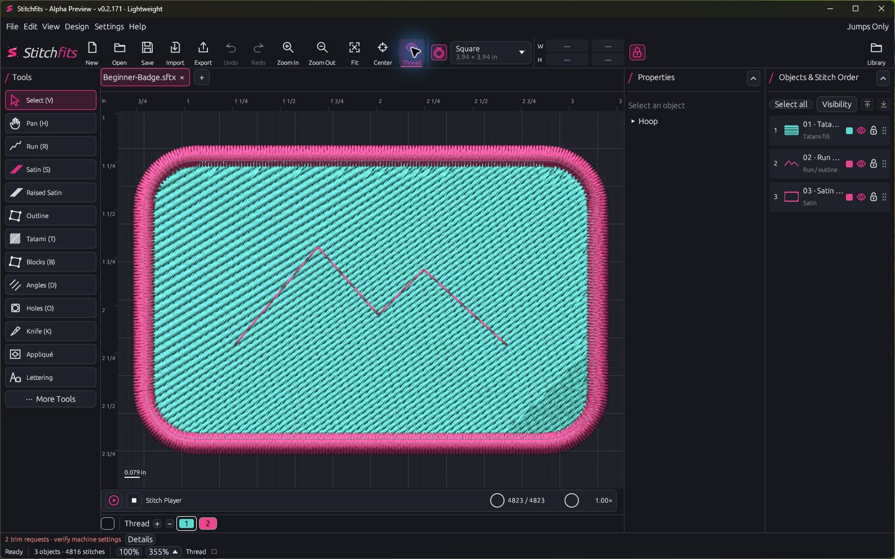
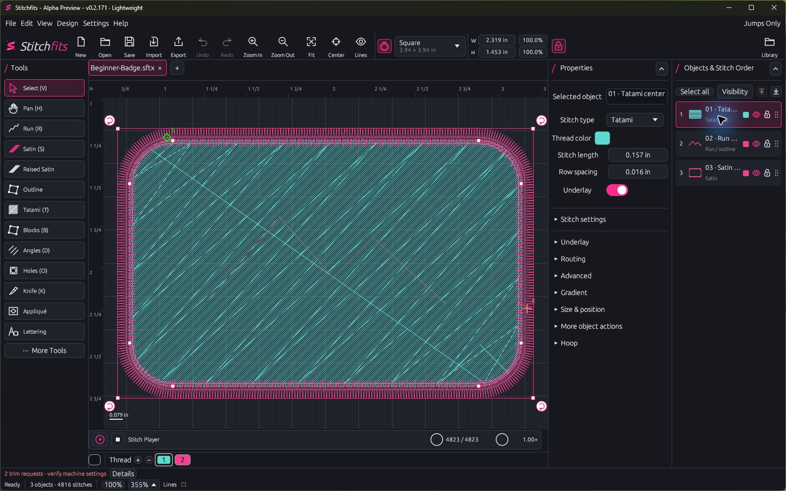

<!-- stitchfits-tester-readme -->
# Stitchfits

**Free embroidery digitizing software for Windows.** Create stitch designs from drawings, logos, or lettering. See how the design will sew, then export a file for your embroidery machine.

<!-- tester-download:start -->
[**Download Stitchfits v0.2.178 for Windows (ZIP)**](https://github.com/RoguePixelLabs/stitchfits-downloads/releases/download/v0.2.178/Stitchfits-Testers-v0.2.178-Windows-x64.zip) · [What’s new in v0.2.178](https://github.com/RoguePixelLabs/stitchfits-downloads/releases/tag/v0.2.178)
<!-- tester-download:end -->

## What you can do

- **Draw your own stitches.** Use running stitches for fine lines, satin for smooth borders, and Tatami for larger filled areas.
- **Work from artwork.** Bring in a picture or SVG as a guide, or add lettering directly to your design.
- **See how it sews.** Preview the thread, choose colors, and play the design stitch by stitch to check the sewing order.
- **Save and export.** Save an editable Stitchfits project and export machine formats such as DST, PES, EXP, and JEF. Check which format your machine uses.

## Get started

1. Download the Windows ZIP above. It’s for 64-bit Windows and runs without an installer.
2. Right-click the ZIP and choose **Extract All**.
3. Open the extracted folder and double-click **Stitchfits.exe**.

For a first project, try drawing a small filled shape, adding a border, and watching it sew in the **Stitch Player**. Already using Stitchfits? Choose **Help → Check for Updates**.

> **Alpha Preview** is an early test version. Save your editable project and sew a small test on scrap fabric before using a design on a finished item.

<!-- screenshots:start -->
## See it in action

### Thread View

### Editing workspace

<!-- screenshots:end -->

## Optional Digitizing Lab

[Download Digitizing Lab for Windows](https://github.com/RoguePixelLabs/stitchfits-digitizing-lab/releases). It converts artwork into editable embroidery. After installing it, choose **Design → Digitizing Lab** in Stitchfits. The Lab has its own release and update channel.

## Share feedback

Tell us what you tried, what you expected, and what happened. Include your Stitchfits version and a screenshot if you can. [Report an issue on GitHub](https://github.com/RoguePixelLabs/stitchfits-downloads/issues/new).

## Open-source license

Stitchfits is free and open source under GPL-3.0-or-later.

<!-- tester-source:start -->
[Download the matching source for v0.2.178](https://github.com/RoguePixelLabs/stitchfits-downloads/releases/download/v0.2.178/Stitchfits-Source-v0.2.178.zip).
<!-- tester-source:end -->
